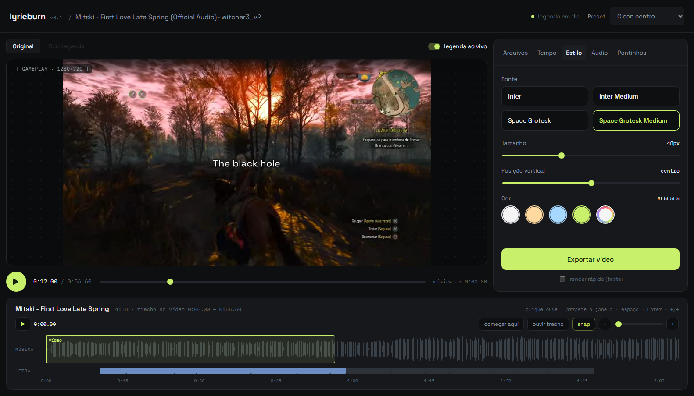
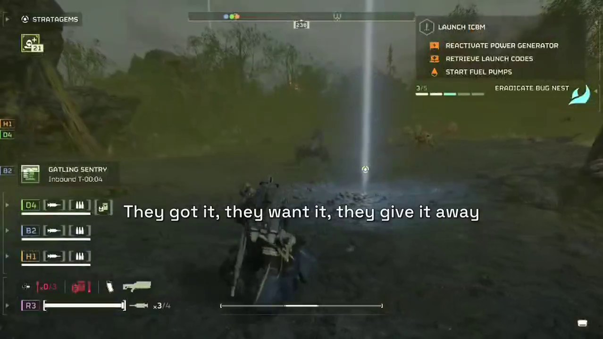
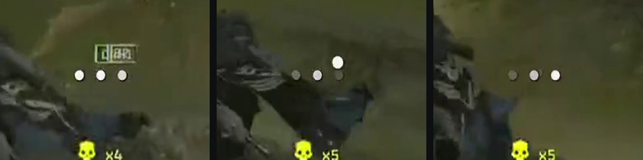

<div align="center">

# lyricburn

**Queima letra sincronizada em cima de vídeo — com a música por cima, fades e pontinhos que dançam no instrumental.**




</div>

Você tem um vídeo (gameplay, clipe, gravação de tela), uma música e a letra
sincronizada dela (`.lrc`, `.srt` ou `.vtt`). O lyricburn junta os três num `.mp4`
pronto pra postar: a música entra por cima do vídeo, a letra aparece linha a linha
no tempo certo, e nos trechos instrumentais três pontinhos `...` pulam acompanhando
as notas.

Dá pra usar pela **linha de comando** ou por um **editor no navegador**, com prévia
ao vivo da legenda e uma timeline da música pra escolher o trecho.

## Sumário

- [O que ele faz](#o-que-ele-faz)
- [Resultado](#resultado)
- [Instalação](#instalação)
- [Usando o editor web](#usando-o-editor-web)
- [Usando a linha de comando](#usando-a-linha-de-comando)
- [Configuração](#configuração)
- [Como funciona](#como-funciona)
- [API](#api)
- [Estrutura do projeto](#estrutura-do-projeto)
- [Decisões técnicas](#decisões-técnicas)
- [Limitações conhecidas](#limitações-conhecidas)
- [Créditos](#créditos)
- [Licença](#licença)

## O que ele faz

- **Detecta sozinho** onde a música termina de verdade (ignora silêncio no fim do
  arquivo), a duração final (o que acabar primeiro, vídeo ou música), a orientação
  do vídeo (horizontal ou vertical, inclusive celular gravado em pé) e se ele tem som.
- **Separa backing vocal**: linha inteira entre parênteses vira uma segunda linha,
  menor, em itálico, logo abaixo da principal.
- **Pontinhos reativos**: nas pausas sem voz, o [librosa](https://librosa.org)
  detecta as notas do instrumental e cada nota acende um ponto, que pula mais
  alto quanto mais aguda ela é.
- **Começa pela letra**: em vez de minutagem, "comece 2 segundos antes da segunda
  vez que aparece *they got it*".
- **Mixa o som do jogo** com a música — volume fixo ou *ducking* (o jogo abaixa
  sozinho quando a música está forte).
- **Escala tudo**: os tamanhos são calibrados em 720p e se ajustam a qualquer
  resolução de saída, horizontal ou vertical (Reels/TikTok).
- **Editor web** com prévia ao vivo da legenda desenhada pelo mesmo motor do
  export, timeline da música com snap em linhas e beats, e render em background
  com barra de progresso.

## Resultado

| Letra queimada | Pontinhos no instrumental |
|---|---|
|  |  |

Os pontinhos: três quadros da mesma pausa — cada nota detectada acende o próximo
ponto, com um "pop" proporcional à força da nota.

## Instalação

**Requisitos:** Python 3.11+ e [ffmpeg](https://ffmpeg.org/download.html) no PATH
(compilado com libass, o que as builds comuns já são). Pra interface web, também
Node.js 20.19+ ou 22.12+.

```bash
git clone https://github.com/victorRicardo1/lyricburn.git
cd lyricburn

pip install -e .              # só a CLI, sem dependências
pip install -e ".[notes]"     # + librosa: pontinhos reativos e beats da timeline
pip install -e ".[web]"       # + FastAPI e uvicorn: a API do editor
```

Sem o librosa tudo funciona — os pontinhos só ficam parados.

> **Windows:** se o `python` do PATH for outro (Anaconda, Spyder…), use o
> launcher: `py -3.13 -m pip install -e ".[notes,web]"`.

## Usando o editor web

São dois processos — a API em Python e a interface em Angular:

```bash
python -m lyricburn.server            # API em http://127.0.0.1:8000  (docs em /docs)

cd web
npm install
npm start                             # editor em http://localhost:4200
```

O fluxo:

1. **Arquivos** — sobe vídeo, música e letra. A API analisa e mostra o que achou.
2. **Tempo, Estilo, Áudio, Pontinhos** — cada aba tem os mesmos campos do arquivo
   de configuração. A legenda é redesenhada **ao vivo** sobre o vídeo a cada
   mudança, mesmo pausado, então dá pra acertar fonte, cor, tamanho e posição sem
   exportar.
3. **Timeline** — a faixa de baixo é a música inteira. A região verde é o trecho
   que entra no vídeo: arraste pra escolher, ou ouça e aperte Enter onde quiser
   começar.
4. **Exportar** — renderiza em background com progresso. Depois, o botão
   **Com legenda** toca o resultado no próprio editor. Não gostou? Ajuste e use
   **Regerar com as mudanças**.

O projeto fica na URL (`?project=…`) e os ajustes no navegador, então dar F5 não
perde nada.

### Atalhos da timeline

Com a timeline em foco (clique nela):

| Ação | O que faz |
|---|---|
| passar o mouse | mostra o tempo e a linha da letra naquele ponto |
| clicar na waveform ou num bloco da letra | ouve a música dali |
| duplo clique num bloco | o vídeo começa nessa linha (menos o `lead_in`) |
| `Espaço` | toca / pausa |
| `Enter` ou **começar aqui** | o vídeo começa no ponto que você está ouvindo |
| `←` `→` | move o trecho 0,1 s (com `Shift`, 1 s) |
| **ouvir trecho** | toca exatamente a música que vai estar no vídeo |
| **snap** | ao soltar a região, encaixa no início de uma linha ou num beat |

Detalhes de implementação do editor em [`web/README.md`](web/README.md).

## Usando a linha de comando

O jeito mais curto:

```bash
lyricburn render --video gameplay.mp4 --audio musica.mp3 --lyrics musica.lrc --start 2:26
```

Pra ajustar e reaproveitar, use um arquivo de configuração:

```bash
lyricburn init meu_video.toml                     # cria um exemplo comentado
lyricburn info meu_video.toml                     # mostra o que foi detectado, sem renderizar
lyricburn preview meu_video.toml --at 3,15,0:40   # frames .png pra conferir estilo e posição
lyricburn render meu_video.toml --fast            # render rápido de teste
lyricburn render meu_video.toml                   # render final
```

Qualquer opção pode ser sobrescrita na hora:

```bash
lyricburn render meu_video.toml --set style.size=54 --set audio.game_volume=0.2
```

**Começar por uma linha da letra** em vez de minutagem — primeiro veja onde ela aparece:

```bash
lyricburn lines musica.lrc --grep "they got it"
```

```toml
[timing]
start_at_lyric = "they got it"
occurrence = 2      # a segunda vez que ela aparece
lead_in = 7.76      # quantos segundos antes da linha a música começa
```

**Baixar a letra sincronizada** do [LRCLIB](https://lrclib.net):

```bash
lyricburn fetch "Metric" "Lost Kitten"
```

| Comando | O que faz |
|---|---|
| `render` | gera o vídeo final (`--fast` pra teste, `--keep-ass` salva a legenda pra abrir no Aegisub) |
| `preview` | frames `.png` com a legenda em instantes escolhidos |
| `info` | resumo do que foi detectado (`--no-notes` pula a análise de áudio) |
| `lines` | lista as linhas da letra com tempo (`--grep` filtra) |
| `init` | cria um `.toml` de exemplo comentado |
| `fetch` | baixa o `.lrc` do LRCLIB |

Um exemplo completo está em [`exemplos/lost_kitten.toml`](exemplos/lost_kitten.toml).

## Configuração

Caminhos no `.toml` são relativos ao próprio arquivo. Tempos aceitam `146`,
`"2:26"` ou `"2:26.5"`.

<details>
<summary><b>[timing]</b> — de onde a música começa e até onde vai</summary>

| Campo | Padrão | O que faz |
|---|---|---|
| `music_start` | `0` | de que ponto da música o vídeo começa |
| `start_at_lyric` | `""` | alternativa: começa por uma linha da letra que contém esse texto |
| `occurrence` | `1` | qual ocorrência dessa linha (1 = a primeira) |
| `lead_in` | `2.0` | segundos antes da linha escolhida |
| `video_offset` | `0` | em que segundo do vídeo a música entra |
| `lyrics_offset` | `0` | ajuste fino de sync: `+0.2` atrasa a letra, `-0.2` adianta |
| `end` | `"auto"` | `auto` = o que acabar primeiro · `video` · `music` |
| `max_duration` | `0` | corta o vídeo nessa duração (0 = sem limite) |

</details>

<details>
<summary><b>[style]</b> — aparência da legenda</summary>

| Campo | Padrão | O que faz |
|---|---|---|
| `font` | `"Space Grotesk Medium"` | família da fonte (o nome que o libass procura) |
| `size` | `48` | tamanho em px num vídeo de 720p — escala sozinho |
| `color` | `"#F5F5F5"` | cor do texto |
| `position` | `"center"` | `center` · `bottom` · `top` · ou de `0` (topo) a `1` (base) |
| `outline` / `shadow` | `1.4` / `1.6` | espessura do contorno e da sombra |
| `spacing` | `0.2` | espaço entre letras |
| `line_fade_ms` | `220` | fade de entrada e saída de cada linha |
| `back_font` / `back_size` | `"Space Grotesk"` / `32` | fonte e tamanho do backing vocal |
| `back_italic` / `back_opacity` | `true` / `0.8` | itálico e opacidade do backing vocal |
| `fonts_dir` | `""` | pasta extra com `.ttf`/`.otf` |

</details>

<details>
<summary><b>[audio]</b> — mixagem</summary>

| Campo | Padrão | O que faz |
|---|---|---|
| `game_volume` | `0.30` | volume do som original do vídeo |
| `music_volume` | `1.0` | volume da música |
| `music_fade_in` | `0.8` | fade de entrada da música, em segundos |
| `duck` | `false` | abaixa o jogo só quando a música está forte (sidechain) |

</details>

<details>
<summary><b>[video]</b> — saída</summary>

| Campo | Padrão | O que faz |
|---|---|---|
| `resolution` | `720` | lado menor da saída (720p, 1080p…) — vale pra vertical também |
| `fade_in` / `fade_out` | `1.2` / `2.5` | fade de abertura e fechamento, em segundos |
| `crf` | `22` | qualidade do x264 (menor = melhor e maior) |
| `preset` | `"slow"` | preset do x264 (mais lento = arquivo menor) |

</details>

<details>
<summary><b>[dots]</b> — os pontinhos do instrumental</summary>

| Campo | Padrão | O que faz |
|---|---|---|
| `enabled` | `true` | mostra os pontinhos nas pausas |
| `min_gap` | `1.2` | pausa mínima sem voz, em segundos, pra eles aparecerem |
| `reactive` | `true` | reagem às notas (precisa do librosa) |
| `radius` / `spacing` | `5.5` / `26` | tamanho dos pontos e distância entre eles |

</details>

**Fontes:** Space Grotesk e Inter vêm junto (licença OFL, em `lyricburn/fonts`).
Pra usar outra, aponte `style.fonts_dir` pra pasta dela e use o nome da família em
`style.font`. No Windows e no macOS, fontes instaladas no sistema também funcionam.

## Como funciona

```
letra (.lrc/.srt/.vtt) ─┐
música ─────────────────┼─►  plan  ─►  .ass  ─►  ffmpeg  ─►  .mp4
vídeo ──────────────────┘   (fatos)   (estilo)  (pixels)
```

O núcleo é um pipeline de quatro estágios, e cada um só conhece a língua do próximo:

| Módulo | Papel |
|---|---|
| `lyrics.py` | lê a letra e separa linha principal de backing vocal |
| `plan.py` | decide **o que é verdade**: duração, resolução, trecho, pausas e notas |
| `ass.py` | decide **como aparece**: estilos, fades e a animação dos pontinhos |
| `render.py` | monta o filtergraph do ffmpeg: escala, legenda, fades e mixagem |

O `Plan` é o contrato central — um retrato de tudo que foi detectado, que os
estágios seguintes só leem. Por isso a CLI e a API são duas cascas finas sobre o
mesmo núcleo, sem lógica duplicada.

A parte delicada é que existem **três linhas do tempo**: a da música (onde vivem
o `.lrc` e o `music_start`), a do vídeo de saída (onde vivem o `.ass` e o ffmpeg)
e a do trecho analisado pelo librosa. A conversão inteira cabe numa linha do
`plan.py`:

```python
shift = video_offset - music_start + lyrics_offset
```

## API

A API (`lyricburn/server/`, FastAPI) expõe o mesmo núcleo por HTTP. Com ela no ar,
a documentação interativa fica em `http://127.0.0.1:8000/docs`.

| Rota | O que faz |
|---|---|
| `POST /projects` | sobe vídeo + música + letra; devolve metadados, linhas e waveform |
| `GET /projects/{id}` | relê um projeto já analisado |
| `GET /projects/{id}/media/{video\|audio}` | serve o arquivo com `Range` (seek no `<video>`) |
| `GET /projects/{id}/preview?format=mp4\|webm` | cópia leve que o navegador toca (pra `.mkv`/HEVC) |
| `GET /projects/{id}/peaks?buckets=N` | waveform em outra resolução (zoom da timeline) |
| `GET /projects/{id}/beats` | beats da música (librosa), com cache |
| `POST /projects/{id}/plan` | config → `.ass` + resumo do que foi detectado |
| `POST /projects/{id}/render` | inicia o render em background; devolve um job |
| `GET /jobs/{id}` | progresso: %, frame, fps, velocidade e ETA |
| `GET /jobs/{id}/video?format=mp4\|webm` | o vídeo pronto, pra tocar no navegador |
| `GET /jobs/{id}/download` | o `.mp4` pronto |
| `GET /fonts` · `GET /fonts/{nome}` | fontes disponíveis e o arquivo de cada uma |
| `GET /config/defaults` | os valores padrão de todas as opções |

| Variável de ambiente | Pra quê |
|---|---|
| `LYRICBURN_WORK_DIR` | onde ficam uploads, caches e renders (padrão: temp do sistema) |
| `LYRICBURN_FONTS_DIR` | pasta extra de fontes, como o `style.fonts_dir` |
| `LYRICBURN_MAX_RENDERS` | quantos renders rodam ao mesmo tempo (padrão: 1) |

## Estrutura do projeto

```
lyricburn/
├── lyricburn/                núcleo + CLI (Python, sem dependências obrigatórias)
│   ├── cli.py                os comandos render, preview, info, lines, init, fetch
│   ├── config.py             defaults, .toml e --set
│   ├── lyrics.py             leitura de .lrc / .srt / .vtt
│   ├── audio.py              ffprobe, fim real da música, notas (librosa)
│   ├── plan.py               o que foi detectado → Plan
│   ├── ass.py                Plan → legenda .ass
│   ├── render.py             .ass + mídia → ffmpeg
│   ├── fonts/                Space Grotesk e Inter (OFL)
│   └── server/               API FastAPI do editor
│       ├── app.py            rotas
│       ├── planning.py       config da UI → núcleo, com cache de Plan e de notas
│       ├── jobs.py           renders em background, progresso do ffmpeg
│       ├── preview.py        cópias leves pro navegador (H.264 / VP9)
│       ├── beats.py          beats pro snap da timeline
│       ├── media.py          metadados e waveform (RMS)
│       ├── fonts.py          lê o nome das fontes direto do .ttf/.otf
│       └── store.py          projetos em disco
├── web/                      editor (Angular 20, standalone components + signals)
│   └── src/app/
│       ├── core/             tipos, cliente da API e stores
│       └── ui/               cabeçalho, prévia, painel com abas, timeline
├── exemplos/                 configuração de exemplo
└── docs/                     imagens e mockup
```

## Decisões técnicas

- **Um `.ass` só pra tudo.** A legenda que o editor desenha, a que o export queima
  e a que a CLI geraria são o mesmo arquivo, byte a byte. A prévia usa o
  [JASSUB](https://github.com/ThaUnknown/jassub) — o libass compilado pra
  WebAssembly, o mesmo motor que o ffmpeg usa. Ou seja, a prévia não imita o
  resultado com CSS: ela *é* o resultado.
- **Dois caches, porque o custo está em dois lugares.** As notas do librosa ficam em
  disco por projeto + início da música + pausas; o `Plan` fica em memória pela
  parte da configuração que ele realmente usa. Como o estilo não entra em nenhuma
  das duas chaves, mexer num slider de cor responde em ~0,1 s em vez de reanalisar
  o áudio.
- **Um único ponto de contato com o ffmpeg.** A CLI e a API chamam o mesmo
  `render.build_command()`; a API só acrescenta `-progress pipe:1` pra mostrar o
  andamento.
- **Prévia que funciona com qualquer vídeo.** Se o navegador não toca o arquivo
  original (`.mkv`, HEVC), a API gera uma cópia leve em H.264 ou VP9 sob demanda.
- **Waveform por RMS, não por pico.** Música masterizada fica perto do volume
  máximo quase o tempo todo; com pico o desenho saía uma barra chapada, com RMS
  dá pra ver refrão, ponte e instrumental.

## Limitações conhecidas

- **Os jobs de render vivem na memória da API.** Se ela reiniciar, o histórico de
  exports some (os `.mp4` continuam no disco) e não dá pra cancelar um render em
  andamento.
- **O padrão de `LYRICBURN_WORK_DIR` é a pasta temporária do sistema,** que o
  Windows limpa de tempos em tempos. Pra guardar projetos, aponte pra uma pasta sua.
- **A análise de beats leva ~15 s** na primeira vez em cada música (depois vem do
  cache). O snap nas linhas da letra funciona enquanto isso.
- **Letras não vêm no repositório** — elas têm direitos autorais. Use as suas ou
  baixe com `lyricburn fetch`.

## Créditos

- [FFmpeg](https://ffmpeg.org) e [libass](https://github.com/libass/libass) — render e legendas
- [librosa](https://librosa.org) — detecção de notas e beats
- [JASSUB](https://github.com/ThaUnknown/jassub) — libass no navegador
- [wavesurfer.js](https://wavesurfer.xyz) — waveform e regiões da timeline
- [LRCLIB](https://lrclib.net) — letras sincronizadas
- [Space Grotesk](https://github.com/floriankarsten/space-grotesk) e [Inter](https://rsms.me/inter/) — fontes, licença OFL

## Licença

[MIT](LICENSE) © Ricardo Victor. As fontes incluídas seguem a SIL Open Font License.
